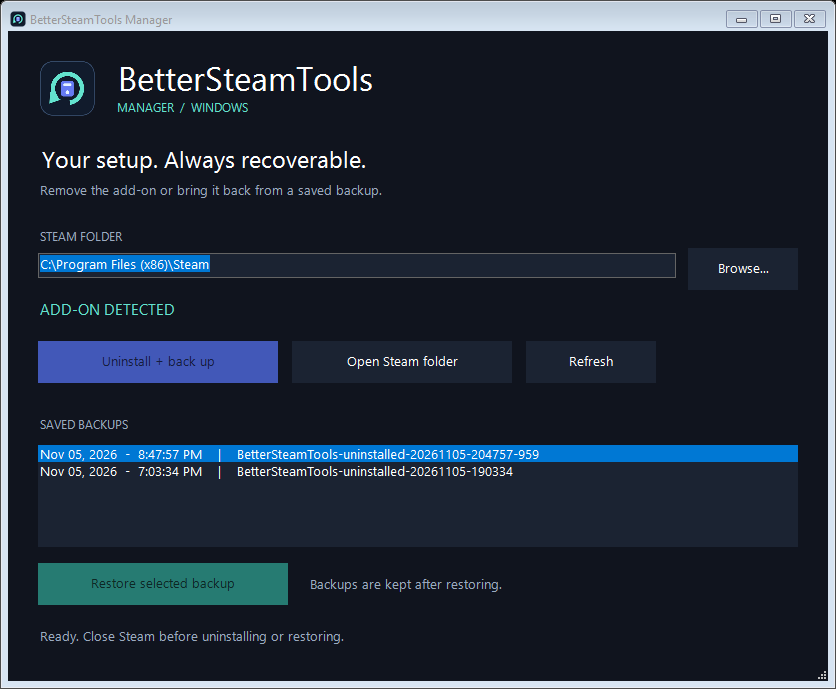

# BetterSteamTools Manager

A small Windows desktop app for removing BetterSteamTools and restoring it from your own timestamped backups.

## Run

Extract the complete app ZIP and double-click **BetterSteamTools-Manager.exe** (or **Launch.cmd**). Keep the EXE beside the scripts and assets. The EXE opens Launch.cmd without a console window; the app requests administrator access. Requires Windows 10 or 11 with built-in Windows PowerShell 5.1 and .NET Framework 4.x; no Python is needed to run the app.

Close Steam before making changes. The app detects your Steam folder; use **Browse** for a different installation.

- **Uninstall + back up** moves the identified add-on files into a timestamped folder inside Steam.
- **Restore selected backup** copies files back and keeps the backup for later.
- Existing destination files are never overwritten during restore.
- The original `BetterSteamTools-uninstalled-*` and `BetterSteamTools-backup-*` backup names are supported.
- Interrupted operations report errors; ordinary copy/move failures attempt rollback. Power loss and external file changes can still require manual recovery from the backup.

## What it manages

`OpenSteamTool.dll`, `opensteamtool.toml`, `dwmapi.dll`, `xinput1_4.dll`, `opensteamtool/`, and `config/stplug-in/`.

The main DLL must contain the BetterSteamTools identifier before uninstalling or restoring. These component names match the installation this utility was developed against. Review them if using a different release or other Steam modifications that share these filenames.

This tool does not download BetterSteamTools or ship its binaries, Steam files, personal configuration, or user backups. Reinstall means restoring a local backup. It is an independent utility, unaffiliated with Valve or BetterSteamTools.

## Development

The UI is Windows Forms in `Manager.ps1`; file operations live in `Core.ps1`. Run `powershell -NoProfile -ExecutionPolicy Bypass -File tests/Smoke.ps1` for isolated backup/restore checks. `-Preview` opens the UI without elevation and disables modification buttons.

The original icon can be rebuilt with `python tools/make_icon.py` (Pillow required for artwork generation only).

Build the EXE with `powershell -NoProfile -ExecutionPolicy Bypass -File tools/Build.ps1`. The launcher uses the built-in .NET Framework C# compiler and embeds `assets/manager.ico`.

Licensed under MIT.
